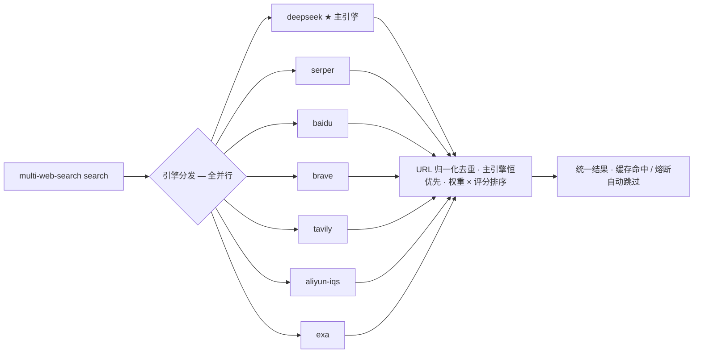

# multi-web-search

> **一个命令,并行聚合 7 大搜索引擎。**
> 搜索不用再挑引擎、不用记各家 API。统一入口一次调用,`deepseek · serper · baidu · brave · tavily · aliyun-iqs · exa` 全并行,主引擎 DeepSeek 优先排序,自动去重、按权重排序、磁盘缓存省配额 —— 结果即用,`--raw` 一丝不苟。


---

## 为什么要用它

- **省心**:多引擎对比、去重、排序、缓存、熔断、代理检测全部内建。装完配一个 key 就能搜,同一条命令在 shell、脚本、CI 里都用。
- **主引擎优先**:默认 DeepSeek 主搜索,结果恒排在最前并标记 `primary ★`;`--engines aux` 切到辅助引擎做交叉验证 / 发散,主搜索 → aux 验证 → DS Fetch 精读,一套工作流。
- **不挑网**:Brave 等直连被墙?自动探测本机代理注入 `HTTPS_PROXY` 走代理,`MULTI_WEB_SEARCH_NO_PROXY=1` 可强制直连。
- **不烧钱**:同参数(query + 引擎集合 + 主引擎 + 条数)15 分钟磁盘缓存命中即回,熔断器把撞墙的引擎闭掉 24h,到期自动恢复。
- **即装即用**:全平台二进制随仓库分发 + 依赖仅 Python 标准库的回落实现 —— 换机器、拷目录都不会断。
- **盯得住**:每引擎独立状态 `multi-web-search status` 一眼看明白谁在干活、谁被熔断。

## 长这样



## 支持的引擎

| 引擎名(`--engines` 用) | 环境变量 | 说明 |
|------|---------|------|
| `deepseek` | `DEEPSEEK_API_KEY` | 主引擎(默认):DeepSeek 搜索 + 网页抓取 |
| `serper` | `SERPER_API_KEY` | Google 搜索结果 |
| `baidu` | `BAIDU_API_KEY` | 中文搜索 |
| `brave` | `BRAVE_API_KEY` | 国际/英文内容 |
| `tavily` | `TAVILY_API_KEY` | AI 优化搜索 |
| `aliyun-iqs` | `ALIYUN_IQS_API_KEY` | 智能通用搜索 |
| `exa` | `EXA_API_KEY` | 语义/AI 搜索 |

配置对应的 API Key 即可使用,无需额外配置;至少配置一个引擎。

## 搜索语法(DeepSeek)

```bash
multi-web-search search 'DeepSeek V4 site:github.com lang:zh after:2025' --engines deepseek
```

`site:` / `lang:` / `after:` / `before:` 等语法透传给搜索服务,单命令拿下精确检索。

## 二进制

平台二进制直接携带在技能目录 `skills/multi-web-search/scripts/` 下:

| 平台 | 路径 |
|------|------|
| Windows (amd64) | `multi-web-search.exe` |
| Linux (amd64) | `multi-web-search-linux` |

调用统一入口 `multi-web-search`(按当前平台自动选择对应二进制执行,无 `.exe`/`-linux` 后缀差异)。

二进制缺失时(拷贝丢文件、未携带该平台)自动回落到同目录的 `multi-web-search.py`:纯标准库实现,与二进制**共享缓存 / 熔断文件与输出格式**(同一 query 的输出逐字节一致),可互换使用——唯一差异是 `key add` 需要二进制做平台级环境变量持久化。启动器同时认 release 资产名(`multi-web-search-windows-amd64.exe`、`multi-web-search-linux-amd64`、`multi-web-search-darwin-arm64` 等),从 release 下载后无需改名即可用。darwin 不在仓库携带列表内,需要时从 release 取。

## 安装

### Claude Code

```bash
# 从 marketplace 安装
claude add plugin lzyyzznl/multi-web-search

# 或手动克隆
git clone git@github.com:lzyyzznl/multi-web-search.git ~/.claude/plugins/multi-web-search
```

### Codex

```bash
# 从 marketplace 安装
codex plugin marketplace add lzyyzznl/multi-web-search --ref main
codex plugin install multi-web-search

# 或手动克隆
git clone git@github.com:lzyyzznl/multi-web-search.git ~/.agents/plugins/multi-web-search
```

### 手动添加 marketplace(可选)

编辑 `~/.claude/settings.json`,在 `extraKnownMarketplaces` 中加入:

```json
{
  "extraKnownMarketplaces": {
    "multi-web-search-marketplace": {
      "source": {
        "source": "url",
        "url": "git@github.com:lzyyzznl/multi-web-search.git"
      }
    }
  }
}
```

## 使用

```bash
# 搜索(默认漂亮输出;DeepSeek 为主引擎,结果优先展示)
multi-web-search search "Rust 异步编程"

# JSON 格式
multi-web-search search "cloud computing" --json

# 管道友好
multi-web-search search "量子计算" --raw | jq '.results[] | {title, url, score}'

# 指定引擎 + 条数 + 跳过缓存
multi-web-search search "Rust" --engines serper,exa --num 5 --no-cache

# 只用辅助引擎做交叉验证/发散(排除主引擎 deepseek)
multi-web-search search "Rust" --engines aux --raw

# 关闭主引擎优先(纯多引擎评分排序)
multi-web-search search "Rust" --primary ""

# DeepSeek 支持 site:/lang:/after:/before: 等搜索语法(透传给搜索服务)
multi-web-search search 'DeepSeek V4 site:github.com lang:zh after:2025' --engines deepseek

# 网页抓取正文(DeepSeek Fetch API,需 DEEPSEEK_API_KEY)
multi-web-search fetch "https://example.com/article"     # 输出 Markdown 正文
multi-web-search fetch "https://example.com/article" --json  # {url, title, content}

# 自定义整体超时(秒)
multi-web-search search "大模型" --timeout 15

# 查看各引擎状态
multi-web-search status
```

### 参数说明

| 参数 | 说明 | 默认 |
|------|------|------|
| `--num N` | 每个引擎返回条数 | 10 |
| `--engines a,b` | 只用指定引擎(逗号分隔);`all`=全部,`aux`=除主引擎外 | 全部已配置 |
| `--primary NAME` | 主引擎:结果优先排序并标记 `primary`;`""` 关闭 | `deepseek` |
| `--timeout N` | 整体超时(秒),超时引擎标记失败 | 8 |
| `--no-cache` | 跳过磁盘缓存,强制实时搜索 | 关 |
| `--json` / `--raw` | JSON 输出 | 漂亮输出 |

结果默认缓存 15 分钟(按 query + 引擎集合 + 主引擎 + 条数的签名哈希存于 `~/.cache/multi-web-search/`),相同参数重复搜索直接命中缓存,节省付费 API 调用。

### 输出示例

```
搜索 "Rust 异步编程" — 主引擎 deepseek — 来自 6 个引擎

  ✅ deepseek    (10 条, 1420ms) ★ primary
  ✅ serper      (10 条, 1680ms)
  ✅ baidu       (10 条, 933ms)
  ✅ brave       (10 条, 773ms)
  ✅ tavily      (10 条, 1174ms)
  ✅ aliyun-iqs  (10 条, 1192ms)

  1. Rust学习笔记-异步编程(async/await/Future)
     https://zhuanlan.zhihu.com/p/611587154
     async/await 是 Rust 的异步编程模型...  [0.78 | deepseek ★ | 2源]

  2. GitHub - rustcn-org/async-book
     https://github.com/rustcn-org/async-book
     高质量手翻 Asynchronous Programming in Rust...  [0.71 | brave]
  ...

  📊 60 条原始结果,去重后 41 条唯一结果 (1.68s)
```

## 特性

- **全并行** — goroutine 同时调用所有可用引擎,互不影响
- **主引擎优先** — 默认 DeepSeek 为主引擎,结果恒排在辅助引擎之前并标记 `primary ★`;`--primary ""` 关闭,回到纯多引擎评分排序
- **交叉验证** — 同一 URL 保留主引擎元数据并累计 `engine_scores`,多引擎命中输出 `agreement`
- **自动发现** — 自动检测环境变量中的 API Key
- **代理自动检测** — 二进制内嵌:已设 `HTTPS_PROXY` 沿用;Windows 读注册表代理(`ProxyEnable`/`ProxyServer`,支持 `http=...;https=...` 多协议格式)并验证端口监听;Linux/macOS 探测常见本地代理端口(`10808/10809/7890/7897/1080/8081/8888`)。检测到可用代理自动注入 `HTTPS_PROXY` 走代理,无代理直连。`MULTI_WEB_SEARCH_NO_PROXY=1` 可强制直连。适合 Brave 等直连被墙的引擎。
- **整体超时** — 单次搜索总超时(默认 8s),超时引擎标记失败不阻塞整体
- **熔断保护** — 配额耗尽(429/403)或连续失败后熔断 24h,到期自动恢复(进程级锁 + 原子写保护状态文件)
- **磁盘缓存** — 参数级签名缓存 15 分钟,相同参数命中缓存,节省付费 API 调用
- **智能去重** — URL 归一化后去重,保留最高评分
- **综合排序** — 主引擎优先 × 引擎权重 × 评分降序
- **跨会话持久化** — 熔断状态保存在 `~/.config/multi-web-search/circuit.json`
- **多平台构建** — build.sh 交叉编译 linux/darwin/windows (amd64/arm64)

## 熔断说明

每个引擎独立维护熔断器:

- 429/403 → 立即熔断 24 小时(配额已耗尽)
- 5xx/超时 → 连续失败 3 次后熔断 24 小时
- 到期自动恢复,无需人工干预

```bash
# 查看各引擎状态
multi-web-search status
```

## 开发

```bash
cd src
go mod tidy
bash build.sh   # 本地构建 + 多平台交叉编译到 dist/
```

构建产物输出到 `dist/`(版本号由 git describe 注入)。`scripts/` 中放的是统一入口启动器 + 就地二进制:构建后把对应平台产物复制到 `skills/multi-web-search/scripts/`(Windows → `multi-web-search.exe`,Linux → `multi-web-search-linux`)随仓库分发。CI 按 tag 把 dist/ 全平台产物上传到 GitHub Release。

## 插件结构

```
multi-web-search/
├── .claude-plugin/          # Claude Code 插件配置
├── .codex-plugin/           # Codex 插件配置
├── src/                     # Go 源码
│   ├── cmd/
│   │   ├── root.go          # CLI 入口(search + fetch + status)
│   │   ├── search.go        # 全并行编排器
│   │   ├── fetch.go         # DeepSeek Fetch 网页抓取
│   │   ├── merge.go         # URL 去重 + 排序
│   │   ├── circuit.go       # 熔断器
│   │   ├── env.go           # API Key 自动检测
│   │   ├── proxy.go         # 代理自动检测(内嵌)
│   │   └── engines/         # 各引擎实现
│   ├── main.go
│   └── build.sh
├── skills/multi-web-search/ # 技能文档 + 统一入口启动器 + 就地平台二进制
│   └── scripts/
│       ├── multi-web-search          # 统一入口(按平台 exec 真身,缺失时回落 Python)
│       ├── multi-web-search.py       # Python 回落实现(与 Go 行为对齐)
│       ├── multi-web-search.exe      # Windows amd64 二进制
│       └── multi-web-search-linux    # Linux amd64 二进制
├── hooks/                   # 生命周期钩子(PATH 注入统一入口目录)
└── AGENTS.md                # 项目配置
```

## License

MIT License,见 [LICENSE](./LICENSE)。
